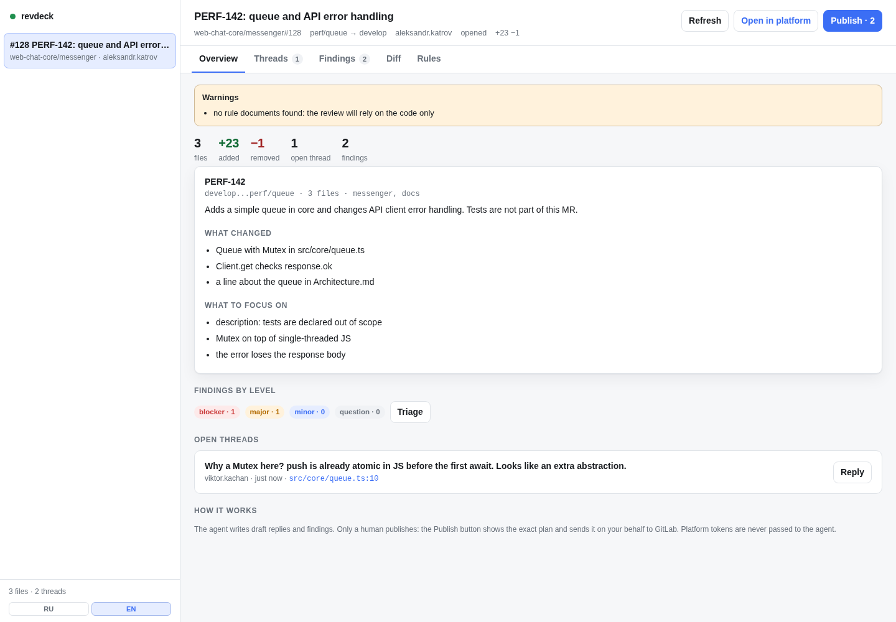

# revdeck

[](https://www.npmjs.com/package/revdeck)
[](https://github.com/katrov/revdeck/actions/workflows/ci.yml)
[](LICENSE)
[](https://nodejs.org)

**Agent-first code review for GitLab and GitHub.**

revdeck gives an agent the review context and the project's own rules, lets it write findings and
replies, and keeps publishing under human control. It runs as a local daemon with a CLI, an MCP server
and a web UI. Platform tokens stay on the host.



[Русская версия](README.ru.md) · [Documentation](docs/README.md) (English and Russian)

## Why

- **Rules, not vibes.** For every changed path revdeck selects the repository documents and the exact
  sections (`AGENTS.md`, architecture, style guides, ADRs). The agent gets a deterministic, size-limited
  context instead of generic “review this PR” instructions.
- **Humans publish.** The agent writes drafts. The UI shows exactly what will be posted; publishing is
  bound to a hash of the plan and is idempotent. There is no “agent approved its own comment” path.
- **Tokens never reach the agent.** The daemon calls `glab`/`gh` on the host and scrubs platform tokens
  from child environments. A sandboxed agent only gets an RPC.
- **GitLab and GitHub.** One model: MR/PR, threads, diff, resolve, reactions, line comments.
- **Many reviews.** The daemon keeps them in SQLite; the UI is a triage queue with keyboard shortcuts.
- **Any harness.** MCP tools for MCP clients, the same capabilities over CLI, and a skill that carries
  the review procedure.

## How it works

```
agent (MCP/CLI) ──unix socket──▶ revdeck daemon ──glab/gh──▶ GitLab / GitHub
                                      │
                                SQLite + Svelte UI ◀── human
```

## Install

Requirements: Node.js ≥ 22.13 (Node 24 LTS recommended — `node:sqlite` is experimental in 22.x), `git`, and an authenticated platform CLI
(`glab auth login` or `gh auth login`). revdeck never reads or stores their tokens.

```bash
# one-off
npx revdeck@latest init

# or install globally for daily use
npm install -g revdeck
revdeck init
```

In a repository:

```bash
cd /path/to/repo
revdeck init          # .revdeck.yml, skill for your harnesses, MCP config
revdeck doctor        # node, glab/gh auth, daemon, adapters
revdeck open 42       # load an MR/PR
revdeck ui            # open the local UI
```

`init` never overwrites an existing config without `--force`, and it merges `.mcp.json` instead of
replacing it. Auto-start on login: `revdeck daemon install` (systemd user unit on Linux, launchd plist
on macOS). Use a global install for this — an `npx` cache path can be evicted.

## Languages

The product is bilingual (Russian and English), and the two languages are independent:

- **Interface and CLI**: follow `--lang ru|en`, then `REVDECK_LANG`, then the system locale. The UI has
  a RU/EN switch in the sidebar and remembers your choice.
- **Review output** (findings, replies, summary): `output.language: auto | ru | en` in `.revdeck.yml`.
  `auto` follows the language of the MR description and threads, so a Russian team can review an
  English repo and still get Russian comments (or the other way round).
- **Skill**: `revdeck init --lang en` installs the English procedure; without the flag init follows
  `REVDECK_LANG`/the system locale and defaults to English.
- **Project rules** can be written in any language: revdeck reads UTF-8 documents and matches headings
  (including Cyrillic) without translation. Rules are quoted as-is.

MCP tool descriptions are English — that is the model-facing layer; prompt text follows
`REVDECK_LANG`. The daemon reads the language at startup, so restart it after changing the language
(`revdeck daemon restart`).

Documentation is available in English (`docs/`, canonical) and Russian (`docs/ru/`). English and
Russian READMEs live in this repository; translation fixes are welcome.

## Commands

| Command | What it does |
|---|---|
| `revdeck init` | config, harness adapters, MCP |
| `revdeck doctor` | environment, `glab`/`gh` auth, daemon, adapters |
| `revdeck list [--remote]` | tracked reviews or open ones from the platform |
| `revdeck open <N\|URL>` | load a review |
| `revdeck context <N>` | agent context: rules, files, threads, findings |
| `revdeck diff <N> [--file]` | files and hunks |
| `revdeck threads <N>` | discussions |
| `revdeck findings <N> set --file f.json` | write findings |
| `revdeck reply <N> --thread <id> --body …` | draft a reply |
| `revdeck publish <N> [--yes]` | preview or publish after confirmation |
| `revdeck notes <N> …` | line comments from the human |
| `revdeck react <N> --note <id> --emoji <name>` | toggle a reaction on a platform comment |
| `revdeck rules [--explain <path>]` | effective rules |
| `revdeck checks <N> [--run --yes]` | project checks |
| `revdeck export/import <N>` | legacy file exchange |
| `revdeck ui [N]` | local web UI |
| `revdeck daemon <start\|stop\|status\|logs\|install>` | daemon lifecycle |
| `revdeck mcp` | MCP server over stdio |

Common flags: `--json`, `--root`, `--review`, `--platform`, `--project`, `--host`, `--lang ru|en`.

## MCP

```json
{
  "mcpServers": {
    "revdeck": {
      "command": "npx",
      "args": ["-y", "revdeck", "mcp"],
      "env": { "REVDECK_LANG": "en" }
    }
  }
}
```

Tools: `revdeck_status`, `revdeck_list`, `revdeck_open`, `revdeck_context`, `revdeck_threads`,
`revdeck_diff`, `revdeck_rules`, `revdeck_draft_reply`, `revdeck_draft_findings`,
`revdeck_set_summary`, `revdeck_notes`, `revdeck_publish_preview`, `revdeck_publish`.

Publishing requires an `approval_id` that only a human can create (UI or CLI `--yes`). The MCP tool
does not create one. Prompts `review-mr` and `close-feedback` are available in clients that support
MCP prompts.

Harness matrix and slash commands: [docs/integrations.md](docs/integrations.md).

## Rules

`.revdeck.yml` at the repository root:

```yaml
version: 1
output:
  language: auto        # auto | ru | en — язык замечаний и ответов
provider:
  type: gitlab          # auto | gitlab | github
  host: gitlab.example.com
  project: group/project
  base: develop
rules:
  sources: [AGENTS.md, CONTRIBUTING.md]
  map:
    - match: "src/**"
      docs: [docs/Architecture.md, "docs/Styleguide.md#Базовый стиль"]
    - match: "src/state/**"
      docs: [docs/StateManagement.md]
  ignore: ["**/generated/**"]
checks:
  - id: lint
    argv: [npm, run, lint]
    when: ["src/**"]
publish:
  requireApproval: true
  maxComments: 50
```

Document selectors: `docs/File.md`, `docs/File.md#Heading`, `docs/File.md#L10-L25`. Without a config,
revdeck discovers `AGENTS.md`, `CLAUDE.md`, `CONTRIBUTING.md` and `docs/*` and warns when nothing is
found. Full schema: [docs/configuration.md](docs/configuration.md).

## Security

- The daemon listens on loopback and a unix socket (0600). The UI uses a one-time launch token, an
  `HttpOnly`/`SameSite=Strict` cookie, `Host`/`Origin` checks and CSP.
- `glab`/`gh` run without a shell, with `cwd` outside the working copy and a scrubbed environment;
  secrets are redacted from logs and errors.
- Comments are checked for GitLab quick actions, HTML, hidden/bidi characters, mass mentions and
  external images.
- Review text is untrusted data; agent instructions say so explicitly.

Details: [docs/threat-model.md](docs/threat-model.md). The guarantee is: the token does not cross the
sandbox boundary and is not returned over RPC. If a process can read the user's home directory, it can
read the CLI configuration — isolate the agent.

## Architecture

| Path | Contents |
|---|---|
| `src/core` | models, diff parser, rules compiler, findings, sanitizer, safe exec |
| `src/providers` | GitLab and GitHub via `glab`/`gh`, normalized |
| `src/daemon` | SQLite, service, unix-socket RPC, HTTP/SSE, approvals |
| `src/cli` | commands, `init`, `doctor`, export/import |
| `src/mcp` | MCP server over stdio |
| `ui` | Svelte 5 + Vite |
| `skills/revdeck` | review procedures (SKILL, Review, Feedback, Criteria, Rules, Sources) |

More: [docs/architecture.md](docs/architecture.md), [docs/protocol.md](docs/protocol.md),
[ADR-0001](docs/adr/0001-daemon-first.md).

## Development

```bash
npm ci
npm run typecheck     # tsc + svelte-check
npm test              # vitest
npm run build         # dist/cli.js, dist/daemon.js, dist/mcp.js, dist/ui
npm run dev:daemon    # daemon from source
npm run dev:ui        # Vite dev server (the daemon serves dist/ui)
```

Provider tests use recorded CLI responses and need no network. See [CONTRIBUTING.md](CONTRIBUTING.md).

## Status

- Publishing uses regular comments; native drafts (GitLab draft notes, GitHub pending review) are not
  used yet, though the provider interface is ready.
- Project checks are planned by the agent; running them requires `revdeck checks --run --yes`.
- The UI does not open a new review by number; use the CLI and the review appears in the list.
- Thread resolution is in the thread card; reactions are available on thread notes in the UI and through
  `revdeck react`.
- Auto-start is supported on Linux and macOS; on Windows run the daemon manually.

## License

[MIT](LICENSE)
