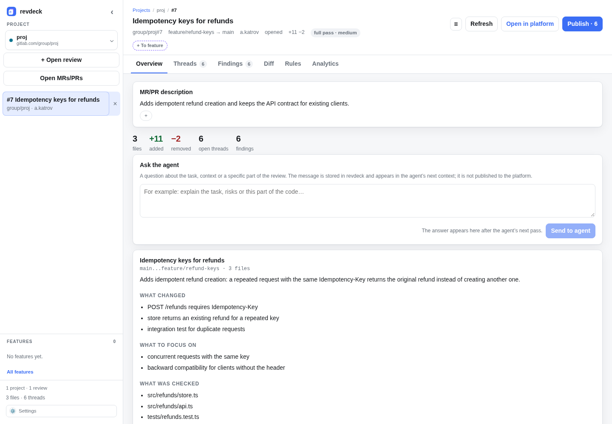

<p align="center">
  <picture>
    <source media="(prefers-color-scheme: dark)" srcset="docs/assets/brand/logo-dark.svg">
    
  </picture>
</p>

# revdeck

[](https://www.npmjs.com/package/revdeck)
[](https://github.com/katrov/revdeck/actions/workflows/ci.yml)
[](LICENSE)
[](https://nodejs.org)

**Agent-first code review for GitLab and GitHub.**

revdeck gives an agent the review context and the project's own rules, lets it write findings and
replies, and keeps publishing under human control. It runs as a local daemon with a CLI, an MCP server
and a web UI. Platform tokens stay on the host.



[Русская версия](README.ru.md) · [Documentation](docs/README.md) (English and Russian)

## Why

- **Rules, not vibes.** For every changed path revdeck selects the repository documents and the exact
  sections (`AGENTS.md`, architecture, style guides, ADRs). The agent gets a deterministic, size-limited
  context instead of generic “review this PR” instructions.
- **Humans publish.** The agent writes drafts. The UI shows exactly what will be posted; publishing is
  bound to a hash of the plan and is idempotent. The devcontainer bridge has no `publish.approve` or
  `publish.commit`: only the human UI or the host CLI can create and execute an approval.
- **Tokens never reach the agent.** The daemon calls `glab`/`gh` on the host and scrubs platform tokens
  from child environments. A sandboxed agent only gets an RPC with read/draft capabilities; the UI
  token is not mounted into the container.
- **Documents are repository files, not local secrets.** Rule and profile documents must be tracked by
  git, have a safe extension and are not read from `.env`, `.git/config`, `.npmrc` or
  `.revdeck.local.yml`.
- **GitLab and GitHub.** One model: MR/PR, threads, diff, resolve, reactions, line comments, attachments.
- **Many projects, separated contexts.** A project is a repository. The UI switches between projects and
  shows only the current one's reviews; an MCP server is scoped to its repository.
- **Explicit cross-project features.** A human bundles MRs from several projects into a feature with a
  brief and contract. A project session reads the combined context; a feature session can draft across its
  members. Publishing stays per review and per human approval.
- **Any harness.** MCP tools for MCP clients, the same capabilities over CLI, and a skill that carries
  the review procedure.
- **Fast reopen.** The UI serves a review from the local snapshot and refreshes a stale one in the
  background; opening never waits for `glab`/`gh`, and background reloads do not restart tab loaders.
- **Open MRs/PRs page.** The sidebar opens a cross-project list of open MRs/PRs with scope, project,
  text, author, target and draft filters; each row can be previewed read-only or opened as a review.
  Opening from the list keeps a clickable breadcrumb, and returning restores the filters and scroll.
- **Settings page.** Theme (system/light/dark), interface language, command reference, the
  Features-section visibility and the auto-refresh interval live on a separate Settings page. The
  daemon stores the choices in SQLite, so they survive a restart; `localStorage` is just a cache for
  the first paint. Auto-refresh repeats the header “Refresh” action
  (off/10/30/60 min, default 10 min) while a review or preview is open and skips background tabs,
  typing and open dialogs.
- **Restart-friendly shell.** A restart rotates the launch token but reuses the last port when it is
  free, so the open tab keeps its origin. The tab and the login page explain what happened and offer
  `revdeck daemon start && revdeck ui --open`; the tab reconnects by itself once a fresh link is
  opened. Unsaved replies and finding comments are kept in `localStorage`; raw `Failed to fetch` and
  401 text is no longer shown.
- **Readable daemon output.** `revdeck daemon start|restart|status|stop` prints one aligned block with
  the UI link, socket, state and health. `daemon logs` renders local timestamps and supports `--follow`
  and `--json`; the log rotates at 1 MiB. `daemon start/restart` accept `--port`. Colors appear only in
  a TTY, so pipes, CI and journald stay clean.
- **Update notice.** The sidebar shows the running version and, when a newer npm release exists, a
  badge; review pages show a dismissible banner with the release link and update command. The About
  card in Settings checks npm manually. The daemon checks at most once per day; set
  `REVDECK_UPDATE_CHECK=0` to turn this off. Nothing is installed automatically.
- **Read-only MR/PR preview.** Open an MR/PR from the “Open review” dialog with “Preview only”:
  description, diff and discussions are available, but findings, comments, reactions and publishing
  are disabled. Previews are cached in memory and do not create a review or metrics event.
- **Risk-sized review.** The context computes a conservative fast/full profile from the diff and the
  changed paths; small docs/code changes get a short pass, while auth, migrations, CI, contracts and
  large diffs require the full procedure.
- **Merge-aware review.** Every open MR/PR review keeps its target branch, diff base/head and merge
  state. Conflict or "behind target" is surfaced before findings, so a clean merge-base diff is not
  mistaken for a mergeable MR. Local diffs and snapshots from older versions may not have merge info.
- **Compact on scroll.** The review header collapses when scrolling down and returns when scrolling
  up; the section tabs stay at the top. This also works inside the independently scrolling Diff pane,
  including its scrollbar and keyboard scrolling. A header button hides it manually; while
  pinned, scrolling and tab switches do not reopen it — only the restore button in the tabs row does.
- **Large lists stay light.** Threads and findings render only visible pages; focus, editors and deep
  links keep working, and small reviews are rendered in full.

## How it works

```
agent (MCP/CLI) ──unix socket──▶ revdeck daemon ──glab/gh──▶ GitLab / GitHub
                                      │
                                SQLite + Svelte UI ◀── human
```

## Install

Requirements: Node.js ≥ 22.13 (Node 24 LTS recommended — `node:sqlite` is experimental in 22.x), `git`, and the platform CLI
(`glab` or `gh`) in the daemon's `PATH`. Sign in on the host (`glab auth login` / `gh auth login`), or
paste a personal access token in the UI: **Settings → GitLab and GitHub access**. The daemon verifies the
token and hands it to the CLI, which stores it; revdeck never keeps a copy. The access card also lists a
missing CLI with an install link and, when a package manager is available on the host, a copyable
command. Set `REVDECK_GLAB` or `REVDECK_GH` to an absolute path if the CLI lives in a
mise/asdf/homebrew shim or a custom location.
`revdeck tools status` shows what the daemon sees; `revdeck tools install gh --dry-run` prints the exact
plan, manager and version before anything runs. `revdeck tools install gh --yes` installs only through a
user-level manager (Homebrew/winget); pacman plans stay manual because they need sudo.

```bash
# one-off
npx revdeck@latest init

# or install globally for daily use
npm install -g revdeck
revdeck init
```

In a repository:

```bash
cd /path/to/repo
revdeck init          # .revdeck.yml, skill for your harnesses, MCP config
revdeck doctor        # node, glab/gh auth, daemon, adapters
revdeck review 42     # someone else's MR: context, rules, review
revdeck feedback 42   # your own MR: work through the discussion
revdeck open 42       # just load an MR/PR without a scenario
revdeck ui            # open the local UI
```

`init` writes `provider.type` from the git remote and falls back to `gitlab` when the host is not
recognized (typical for self-hosted GitLab). Override it with `--provider gitlab|github|auto`.
It never overwrites an existing config without `--force`, and it merges `.mcp.json` instead of
replacing it. `revdeck eject` is the inverse: it removes the config, installed skills and command files,
the `revdeck` MCP entry and the local `.revdeck/` cache, leaving foreign files and other MCP servers
untouched. It only shows the plan by default; add `--yes` to apply (`--keep-config` keeps
`.revdeck.yml`). Auto-start on login: `revdeck daemon install` (systemd user unit on Linux, launchd
plist on macOS). Use a global install for this — an `npx` cache path can be evicted.

If `glab` works in the shell but the UI refresh fails with `spawn glab ENOENT`, the daemon has a
different `PATH` (systemd/launchd often do). Run `revdeck doctor`; it shows the path resolved by the
running daemon. Set `REVDECK_GLAB=/absolute/path/to/glab` (or `REVDECK_GH`), or reinstall the service
with `revdeck daemon install` so it captures the current `PATH`, then restart the daemon.

## Languages

The product is bilingual (Russian and English), and the two languages are independent:

- **Interface and CLI**: follow `--lang ru|en`, then `REVDECK_LANG`, then the system locale. The UI has
  a RU/EN switch in the sidebar and remembers your choice.
- **Review output** (findings, replies, summary): `output.language: auto | ru | en` in `.revdeck.yml`.
  `auto` follows the language of the MR description and threads, so a Russian team can review an
  English repo and still get Russian comments (or the other way round).
- **Skill**: `revdeck init --lang en` installs the English procedure; without the flag init follows
  `REVDECK_LANG`/the system locale and defaults to English.
- **Project rules** can be written in any language: revdeck reads UTF-8 documents and matches headings
  (including Cyrillic) without translation. Rules are quoted as-is.

MCP tool descriptions are English — that is the model-facing layer; prompt text follows
`REVDECK_LANG`. The daemon reads the language at startup, so restart it after changing the language
(`revdeck daemon restart`).

Documentation is available in English (`docs/`, canonical) and Russian (`docs/ru/`). English and
Russian READMEs live in this repository; translation fixes are welcome.

## Commands

| Command | What it does |
|---|---|
| `revdeck init [--provider gitlab/github/auto]` | config, harness adapters, MCP |
| `revdeck eject [--yes]` | remove revdeck-owned config, adapters and MCP entry |
| `revdeck devcontainer [--write]` | mount the host daemon socket/state into a devcontainer |
| `revdeck doctor` | environment, `glab`/`gh` auth, daemon, adapters |
| `revdeck projects [add <path>]` | projects, their roots and review counts; register a repository |
| `revdeck list [--all] [--remote]` | reviews of the current project, or all projects with `--all` |
| `revdeck feature …` | list/create/add/remove/context/update/archive/delete features |
| `revdeck review <N\|URL>` | review someone else's MR: context, rules, diff |
| `revdeck feedback <N\|URL>` | work through findings on your own MR: threads, fixes, replies |
| `revdeck open <N\|URL>` | load a review without a scenario; suggests review or feedback |
| `revdeck context <N> [--scenario review\|feedback]` | agent context: rules, files, threads, findings |
| `revdeck diff <N> [--file]` | files and hunks |
| `revdeck threads <N>` | discussions |
| `revdeck findings <N> set --file f.json` | write findings |
| `revdeck reply <N> --thread <id> --body …` | draft a reply |
| `revdeck publish <N> [--yes]` | preview or publish after confirmation |
| `revdeck notes <N> …` | line comments from the human |
| `revdeck messages <N> [list\|ask\|reply] [--as-agent]` | review-level questions to the agent and its replies |
| `revdeck metrics [project]` | project-level quality metrics and review cycle |
| `revdeck react <N> --note <id> --emoji <name>` | toggle a reaction on a platform comment |
| `revdeck attach <N> --file <image-or-video>` | upload an attachment and print its markdown link |
| `revdeck rules [--explain <path>]` | effective rules |
| `revdeck checks <N> [--run --yes]` | project checks |
| `revdeck export/import <N>` | legacy file exchange |
| `revdeck ui [N]` | local web UI |
| `revdeck daemon <start\|stop\|restart\|status\|logs\|install\|uninstall>` | daemon lifecycle; `--port`, `logs --follow`, `status/logs --json` |
| `revdeck tools [status\|install <glab\|gh\|all>] [--dry-run] [--yes] [--json]` | check/install platform CLIs without sudo |
| `revdeck mcp` | MCP server over stdio |

Common flags: `--json`, `--root`, `--review`, `--platform`, `--project`, `--host`, `--all`, `--lang ru|en`.

## Projects

A project is a repository. revdeck keeps a project registry (`projects`, `project_roots`) and a
`projectKey` on every review, so the UI can switch between projects and show only the current one's
reviews. The daemon still runs as one process with one SQLite database; project separation is about
context, not tenants.

Projects are managed in the projects home: **Add project** registers a working copy
(`revdeck projects add <path>` works too), **Edit** changes the display title and the list of
working-copy roots, and **Delete** removes the project and its cached reviews from revdeck. Deleting
never touches MRs/PRs or comments on the platform.

Each repository's MCP server resolves its project from the working copy and lists only that project.
An id or URL from another project is rejected with a hint to open a separate session. Devcontainers and
separate agent sessions work naturally: each container mounts the same host daemon bridge and stays
scoped to its repository.

An agent never sees another project implicitly. Cross-project work goes through a human-created
feature (below), which is the only explicit door. See [capabilities](docs/capabilities.md#project-scopes) and
[architecture](docs/architecture.md#projects-and-isolation).

## Features

A feature is a named bundle of MRs from one or more projects, with a Markdown brief, a separate
contract (Markdown or OpenAPI), and a free-form role per review. OpenAPI is parsed into operations and
schemas; the context marks which changed reviews mention each path. Application profiles come from
`context.sources` in each repository. Feature notes/findings are a non-published cross-project
scratchpad. Projects are not linked permanently; a project appears in the feature only while one of
its MRs is a member.

```bash
# open the MRs first (in their projects), then:
revdeck feature create "Checkout v2" --brief brief.md --contract openapi.yaml \
  gitlab:gitlab.com/acme/api!1 \
  gitlab:gitlab.com/acme/web!2
revdeck feature context ft-a1b2c3
revdeck feature note ft-a1b2c3 --title "Contract gap" --body "Web sends no Idempotency-Key" --kind finding --level major
```

In the UI, add a review from its header, or open **All features**, choose a feature and add tracked
reviews; reorder and delete are on the feature page. A project session sees features that include its
project and can read the combined context, but writes only in its own project. To let one agent write across a feature's
members, start the MCP server from a member repository with `REVDECK_FEATURE=<feature id>`; publishing
still needs approval per review. Feature notes written by the agent stay local and are never published.
See [capabilities](docs/capabilities.md#features).

UI shortcuts: `1`–`6` switch tabs, `o` opens a review, `r` refreshes, `s` hides/shows the
sidebar, `p` opens the project switcher (or publishing when a plan is ready), `?` or `⌘K`/`Ctrl+K`
opens the command palette, `h` opens the command reference. On the Diff tab `[`/`]` switch files,
`f` focuses the file filter, `t` hides/shows the file tree, `e` expands/collapses hidden lines and
`v` marks the current file viewed. `n`/`N` jump to the next/previous discussion in the Diff. Letter shortcuts use the physical key, so they work in any
keyboard layout and are ignored in text fields and dialogs. The sidebar has a **Command reference**
link (`#/help`) with searchable CLI usage, common flags and UI shortcuts; click a command to copy it.
The sidebar and the active project are stored in `localStorage`.

The UI shows the MR/PR description, supports deep links to threads, findings and diff lines (with
working browser Back/Forward), and keeps a per-review "viewed" state and file filter in the diff.
The Diff tab groups files in a collapsible folder tree that can be hidden or resized, expands hidden
unchanged lines around hunks, has in-file search and a persistent wrap-lines toggle, and renders open
threads and findings inline. Threads support a quick reply (published only after confirmation), and
line comments can insert a `suggestion` block that GitHub/GitLab can apply directly. Review summaries
can be published as a GitHub review or GitLab note with an approve/request-changes verdict after the
usual confirmation. The Overview has a merge-readiness panel (platform CI checks, approvals,
conflicts and open threads), CODEOWNERS for changed files, and a reviewed-head marker that warns about
new commits. Browser notifications about new threads can be enabled in Settings; hovering or focusing
a reaction shows who reacted. A review can be removed from the local sidebar with **×**; this never
deletes the MR/PR on the platform.
A thin progress bar shows review loading. Long paths and URLs wrap or truncate inside cards, and thread,
finding and line-comment paths have a copy button. While a text
field is focused, background updates are deferred so typing is never overwritten; the agent reply on a
line comment can also be edited.

## Attachments

The UI has an **Attach** button next to reply, finding and line-comment editors; the CLI equivalent is
`revdeck attach <N> --file shot.png`. The file is uploaded by the daemon on the host, and the editor
receives a markdown link with an absolute platform URL, so GitLab renders images and videos in the
original MR. Relative GitLab `/uploads/...` links are left for GitLab to expand in the project
context; absolute host-only links are repaired to `https://<host>/-/project/<id>/uploads/...` when the
GitLab project id is known.

GitLab is supported through project uploads (requires a `glab` with `--form` support). GitHub has no
public attachment API, so the button is disabled there and a link must be pasted manually. Only raster
images and videos (PNG, JPEG, GIF, WebP, AVIF, MP4, WebM, OGV, MOV) are accepted; SVG and arbitrary
files are rejected.

Comment editors have GitLab/GitHub-style **Write / Preview** tabs and a Markdown toolbar. Images and
videos from the platform host (including GitLab `/uploads/...` links and `{width=... height=...}`)
render in the preview and in thread comments; external images are shown as links and are never loaded.

## Notes for the agent

Every finding has a private **Note for the agent** field, and every thread has the same note next to the
reply. The text is included in `revdeck_context` / MCP but never published to GitLab or GitHub. Findings
also keep their decision note separately.

## Two scenarios

revdeck has two review procedures, and the command now names the scenario explicitly:

```bash
revdeck review 42     # someone else's MR: Review.md
revdeck feedback 42   # your own MR: Feedback.md
revdeck open 42       # only load; the scenario stays open
```

The same verbs work in the harness command: `/revdeck review 42` and `/revdeck feedback 42`. The
generated command file routes the first argument, and `revdeck_context` / `revdeck context` with
`--scenario review|feedback` carries the same choice into the agent context. The context marks whether
the MR belongs to you (`your MR` / `someone else's MR`), so `open` can suggest the matching command when
the platform user is known. The scenario is client-side: it is not stored in the review, the daemon or
the database. Existing projects get the new router by rerunning `revdeck init`; a command file you have
customized is left alone.

## Multi-agent review

Configure independent reviewers in `.revdeck.yml`:

```yaml
review:
  agents: 3
  roles: [correctness, architecture, tests]
```

The lead agent reads this plan from `revdeck_context`, starts one subagent per role/shard, and gives each
`revdeck context <N> --scenario review|feedback --role <role> --shard i/N` (the MCP tool takes the same
`scenario`, `role` and `shard`). Workers
return findings as JSON and do not write to revdeck; the lead deduplicates by `file:line:title` and writes
the final summary/findings once.

Built-in roles: `correctness`, `architecture`, `tests`, `security`, `performance`, `compatibility`,
`docs`, `concurrency`, `ux`, `data`, `api`, `dependencies`, `observability`, `build`, `privacy`,
`general`. Default is three agents with correctness, architecture and tests. A role list shorter than
`agents` is repeated. Custom roles with a title, description, criteria and instructions live in
`review.customRoles`.

Several reviews can be opened together: `revdeck open 345 344 556` or `revdeck_open` with an array of
inputs. Each review gets its own group of agents; findings from different MRs are never merged.

## Analytics, secrets and history

- **Analytics** tab and `revdeck stats <N>`: accepted/rejected/pending findings, acceptance rate,
  threads, drafts and the list of rejected suggestions with their notes.
- **Change groups**: explicit `review.groups` or automatic grouping by file kind/module; shown in
  Overview and in the agent context.
- **Secret scan** (optional): `review.secrets.enabled: true`; `revdeck scan <N>`; only masked previews
  are exposed.
- **Version history** (optional): `review.history.enabled: true`; `revdeck versions <N>` and the
  Overview timeline.

## Devcontainer

The daemon, `glab` and `gh` stay on the host. From the repository root:

```bash
revdeck devcontainer          # print the mounts and environment
revdeck devcontainer --write  # merge them into .devcontainer/devcontainer.json
```

The command mounts the stable host bridge `~/.local/state/revdeck/devcontainer/run` at `/run/revdeck`
(agent-scoped socket) and `~/.local/state/revdeck/devcontainer/state` at `/var/lib/revdeck` (read-only
info `daemon.json` without the UI token), and sets `REVDECK_RUNTIME_DIR`, `REVDECK_STATE_DIR`,
`REVDECK_DEV_CONTAINER=1` and `REVDECK_UI_HOST`. The JSON uses `${localEnv:HOME}${localEnv:USERPROFILE}` instead of an absolute
home path, so the same `.devcontainer/devcontainer.json` works for every developer. Comments and
foreign keys in an existing JSONC file are preserved.

The daemon runs on the host and cannot read the container workspace path (`/workspaces/...`), so the
same command also writes `REVDECK_HOST_ROOT: "${localWorkspaceFolder}"` into `containerEnv` and
`remoteEnv` (the MCP server inherits it from the container). The devcontainer tooling expands
`${localWorkspaceFolder}` to each developer's host path, so the shared file has no user-specific path.
The CLI and MCP server inside the container replace their worktree path with that host path before
calling the daemon; `.revdeck.yml`, rule documents, checks and local diff bases then come from the host
checkout. If the repository is not the opened workspace folder, set `REVDECK_HOST_ROOT` to the host
repository root manually (for example `${localWorkspaceFolder}/subdir`). Reviews opened before this
mapping still point at the container root: reopen them after updating the devcontainer.

The daemon creates the bridge socket on startup, so on the host run `revdeck daemon restart`, then
rebuild the container. Inside the container revdeck never starts a local daemon, so `gh`/`glab` are
never invoked there; if the host socket is missing it fails with a clear `DEVCONTAINER` error.
`revdeck doctor` is aware of this mode.

On macOS with Docker Desktop the host Unix socket is not proxied into the container. The client then
falls back to HTTP: `revdeck daemon restart` is enough, because the bridge `daemon.json` is readable by
the container user (the private parent stays `0700`) and the loopback server accepts
`Host: host.docker.internal`. On Linux, if the socket is not reachable, use
`revdeck daemon restart --host 0.0.0.0` (or `revdeck daemon install --host 0.0.0.0` for a service);
binding to `0.0.0.0` exposes the HTTP port to the network, so use it only on a trusted network.

`revdeck devcontainer --write` updates `.mcp.json` / `.cursor/mcp.json` inside the repository. A
user-level MCP configuration outside the repository must get the same `REVDECK_*` variables manually;
otherwise it can start a second daemon inside the container.

## MCP

```json
{
  "mcpServers": {
    "revdeck": {
      "command": "npx",
      "args": ["-y", "revdeck", "mcp"],
      "env": { "REVDECK_LANG": "en" }
    }
  }
}
```

Tools: `revdeck_status`, `revdeck_list`, `revdeck_open`, `revdeck_context`, `revdeck_threads`,
`revdeck_diff`, `revdeck_rules`, `revdeck_draft_reply`, `revdeck_draft_findings`,
`revdeck_set_summary`, `revdeck_notes`, `revdeck_messages`, `revdeck_feature`, `revdeck_feature_note`,
`revdeck_publish_preview`, `revdeck_publish`.

Publishing requires an `approval_id` created by the human UI or the host CLI. The agent bridge has no
`publish.approve`, and the MCP tool does not create one. Prompts `review-mr`, `close-feedback` and
`review-feature` are available in clients that support MCP prompts; they mirror `/revdeck review`,
`/revdeck feedback` and the feature workflow.

Harness matrix and slash commands: [docs/integrations.md](docs/integrations.md).

## Rules

`.revdeck.yml` at the repository root; personal overrides go to `.revdeck.local.yml` (ignored by git and
added by `init`). If `.revdeck.local.yml` is tracked by git, it came from the repository and is ignored
as personal overrides. Local objects merge recursively, local arrays replace, and a base
`review.readOnly` cannot be disabled locally.

```yaml
version: 1
output:
  language: auto        # auto | ru | en — язык замечаний и ответов
provider:
  type: gitlab          # auto | gitlab | github
  host: gitlab.example.com
  project: group/project
  base: develop
rules:
  sources: [AGENTS.md, CONTRIBUTING.md]
  map:
    - match: "src/**"
      docs: [docs/Architecture.md, "docs/Styleguide.md#Базовый стиль"]
    - match: "src/state/**"
      docs: [docs/StateManagement.md]
  ignore: ["**/generated/**"]
  maxDocumentBytes: 0   # 0 = no limit
  maxTotalBytes: 0      # 0 = no limit
checks:
  - id: lint
    argv: [npm, run, lint]
    when: ["src/**"]
publish:
  requireApproval: true
  maxComments: 50
```

Document selectors: `docs/File.md`, `docs/File.md#Heading`, `docs/File.md#L10-L25`. Without a config,
revdeck discovers `AGENTS.md`, `CLAUDE.md`, `CONTRIBUTING.md` and `docs/*` and warns when nothing is
found. Full schema: [docs/configuration.md](docs/configuration.md).

## Security

- The daemon listens on loopback and a unix socket (0600). The devcontainer bridge exposes only the
  `read`/`draft` capability set; `publish.*`, `checks.run`, decisions, platform writes and
  feature/project administration return `CAPABILITY`. The UI token stays on the host and is not
  mounted into the container.
- The UI uses a launch token (rotated with the daemon), an `HttpOnly`/`SameSite=Strict` cookie,
  `Host`/`Origin` checks and CSP.
- `glab`/`gh` run without a shell, with `cwd` outside the working copy and a scrubbed environment;
  secrets are redacted from logs and errors.
- A token pasted in the UI is checked with a `GET /user` request, then passed to `glab`/`gh` on stdin
  (never in argv) and stored by the CLI. revdeck does not keep a copy, `auth.status` returns only the
  host, the account and install guidance, and `auth.*` is human-only: the bridge answers `CAPABILITY`.
  The form is disabled when the UI is not opened via `127.0.0.1`, because the token would travel over
  the network.
- Rule/profile documents must be git-tracked, have a safe extension and are denied for local secrets
  (`.env*`, `.git/**`, `.npmrc`, `.revdeck.local.*`, keys); `.revdeck.local.yml` tracked by git is
  ignored as a repository file. Reads use an opened-fd realpath check to close symlink TOCTOU.
- Checks are planned by the agent and run by a human in the UI or the host CLI. The bridge denies
  `checks.run`; the CLI refuses `--run --yes` inside a devcontainer.
- Comments are checked for GitLab quick actions, HTML, hidden/bidi characters, mass mentions and
  external images (only uploads from the platform host are allowed).
- Review text is untrusted data; agent instructions say so explicitly.

Details: [docs/threat-model.md](docs/threat-model.md). The guarantee is: the token does not cross the
sandbox boundary and is not returned over RPC. A token entered in the UI is passed straight to the CLI
and is not kept by revdeck. If a process can read the user's home directory, it can read the CLI
configuration — isolate the agent.

## Architecture

| Path | Contents |
|---|---|
| `src/core` | models, diff parser, rules compiler, findings, sanitizer, safe exec |
| `src/providers` | GitLab and GitHub via `glab`/`gh`, normalized |
| `src/daemon` | SQLite, service, unix-socket RPC, HTTP/SSE, approvals |
| `src/cli` | commands, `init`, `doctor`, export/import |
| `src/mcp` | MCP server over stdio |
| `ui` | Svelte 5 + Vite |
| `skills/revdeck` | review procedures (SKILL, Review, Feedback, Criteria, Rules, Sources, `agents/openai.yaml`) |

More: [docs/architecture.md](docs/architecture.md), [docs/protocol.md](docs/protocol.md),
[capabilities](docs/capabilities.md#daemon-first).

## Development

```bash
npm ci
npm run typecheck     # TypeScript 7 (server) + svelte-check (TS 6)
npm test              # vitest
npm run build         # dist/cli.js, dist/daemon.js, dist/mcp.js, dist/ui
npm run dev:daemon    # daemon from source
npm run dev:ui        # Vite dev server (the daemon serves dist/ui)
```

Provider tests use recorded CLI responses and need no network. See [CONTRIBUTING.md](CONTRIBUTING.md).

## Status

- Publishing uses regular comments; native drafts (GitLab draft notes, GitHub pending review) are not
  used yet, though the provider interface is ready.
- Project checks are planned by the agent; a human runs them in the UI or the host CLI (`revdeck checks --run --yes`); the bridge denies `checks.run`.
- The UI opens a review from the **Open review** dialog; the working-copy root is required so the daemon
  can read `.revdeck.yml`.
- Thread resolution is in the thread card; the **Close thread** button records the resolve intent and
  opens the publish confirmation, so closing is still a human-approved action. Reactions are available
  on thread notes and on the MR/PR description. Own platform comments can be edited or deleted from the
  thread card.
- Reactions are loaded for every thread note after the review snapshot and refresh, so they are visible
  without an extra click.
- Published findings start with a severity marker (🟥 blocker, 🟧 major, 🟨 minor, 🟦 question), so the
  level is visible directly in GitLab/GitHub; the UI badges use the same colors and icons.
- GitHub has no public attachment API: the Attach button is disabled there; uploads work in GitLab.
- Auto-start is supported on Linux and macOS; on Windows run the daemon manually.

## License

[MIT](LICENSE)
