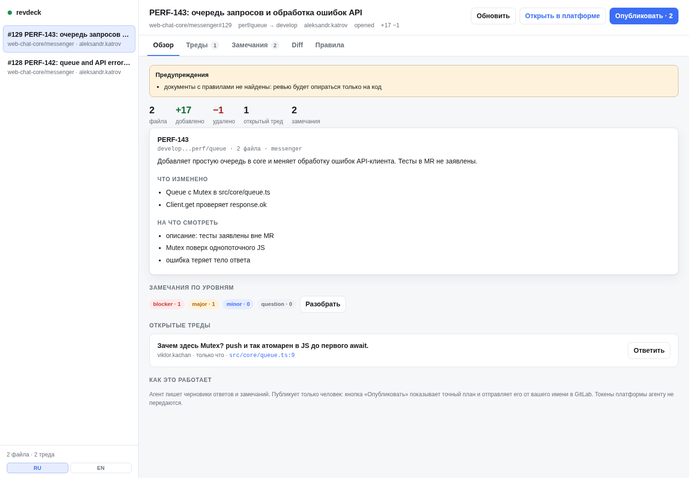

# revdeck

[English](README.md) | Русский · [Документация](docs/ru/README.md)

Локальный код-ревью для GitLab и GitHub, сделанный вокруг агента: агент читает контекст и пишет
черновики, человек подтверждает и публикует. Работает как MCP-сервер, CLI и веб-интерфейс; токены
платформ остаются на хосте.

```
агент (MCP/CLI) ──unix socket──▶ revdeck daemon ──glab/gh──▶ GitLab / GitHub
                                    │
                              SQLite + Svelte UI ◀── человек
```



## Зачем

- **Правила вместо догадок.** Для каждого изменённого пути revdeck выбирает документы репозитория и
  конкретные секции (`AGENTS.md`, архитектура, гайды, ADR). Агент получает детерминированный контекст,
  а не «отревьюй PR по best practices».
- **Публикация только человеком.** Агент пишет черновики ответов и замечаний. В UI видно ровно то, что
  уйдёт в платформу; публикация выполняется по подтверждению, привязанному к хешу плана, и повторно
  не отправляет уже отправленное.
- **Токены не уезжают агенту.** Демон вызывает `glab`/`gh` на хосте и вычищает токены из окружения
  дочерних процессов. Агент в песочнице получает только RPC и не видит ни токена, ни конфигурации
  платформы.
- **GitLab и GitHub.** Одна модель: MR/PR, треды, diff, резолв, реакции, комментарии к строкам, вложения.
- **Несколько ревью.** Демон хранит открытые ревью в SQLite; UI — очередь с поиском и горячими
  клавишами.

## Установка

```bash
npm install -g revdeck
# или разово:
npx revdeck@latest init
```

Требования: Node.js ≥ 22.13 (рекомендуется Node 24 LTS: в 22.x `node:sqlite` экспериментален), `git`, для GitLab — `glab` с выполненным `glab auth login`, для
GitHub — `gh` с `gh auth login`. Токены revdeck не читает и не хранит.

В проекте:

```bash
cd /path/to/repo
revdeck init          # .revdeck.yml, skill в .agents/.claude, MCP-конфиг
revdeck doctor        # проверка окружения и адаптеров
revdeck open 42       # открыть MR/PR по номеру
revdeck ui            # ссылка на локальный интерфейс
```

`revdeck init` не перезаписывает существующий конфиг без `--force` и не трогает чужие ключи в
`.mcp.json`. Обратная операция — `revdeck eject`: удаляет конфиг, установленные скиллы и файлы команд,
запись `revdeck` в MCP и локальный кеш `.revdeck/`, не трогая чужие файлы и другие MCP-серверы. По
умолчанию команда только показывает план; применить — с `--yes` (`--keep-config` оставляет
`.revdeck.yml`). Автозапуск демона при входе в систему — `revdeck daemon install`: создаёт systemd user unit
(Linux) или launchd plist (macOS) и печатает команду включения. Для автозапуска ставьте пакет глобально:
путь в кеше `npx` может быть очищен.

## Языки

Продукт двуязычный (русский и английский), причём языки независимы:

- **Интерфейс и CLI** следуют `--lang ru|en`, затем `REVDECK_LANG`, затем системной локали. В UI есть
  переключатель RU/EN в сайдбаре, выбор запоминается.
- **Язык результатов ревью** (замечания, ответы, выжимка) — `output.language: auto | ru | en` в
  `.revdeck.yml`. `auto` следует языку описания MR и обсуждений: русская команда может ревьюить
  английский репозиторий и получать русские комментарии (и наоборот).
- **Skill**: `revdeck init --lang en` ставит английскую процедуру; без флага язык берётся из
  `REVDECK_LANG`/системной локали, по умолчанию английский.
- **Правила проекта** могут быть на любом языке: revdeck читает UTF-8 и сопоставляет заголовки
  (включая кириллицу) без перевода. Правила цитируются как есть.
- **MCP-описания инструментов** на английском — это машинный слой для модели; тексты промптов
  следуют `REVDECK_LANG`. Демон читает язык при старте: после смены языка перезапустите его
  (`revdeck daemon restart`).

## Команды

| Команда | Что делает |
|---|---|
| `revdeck init` | конфиг, адаптеры, MCP |
| `revdeck eject [--yes]` | удалить конфиг, адаптеры и MCP-запись revdeck |
| `revdeck devcontainer [--write]` | смонтировать сокет/state демона хоста в devcontainer |
| `revdeck doctor` | окружение, `glab`/`gh`, демон, адаптеры |
| `revdeck list [--remote]` | локальные или открытые на платформе ревью |
| `revdeck open <N│URL>` | загрузить ревью |
| `revdeck context <N>` | контекст для агента: правила, файлы, треды, замечания |
| `revdeck diff <N> [--file]` | файлы и hunks |
| `revdeck threads <N>` | обсуждения |
| `revdeck findings <N> set --file f.json` | записать замечания |
| `revdeck reply <N> --thread <id> --body …` | черновик ответа |
| `revdeck publish <N> [--yes]` | план или публикация после подтверждения |
| `revdeck notes <N> …` | комментарии человека к строкам |
| `revdeck react <N> --note <id> --emoji <name>` | поставить или снять реакцию на комментарий платформы |
| `revdeck attach <N> --file <картинка-или-видео>` | загрузить вложение и вывести markdown-ссылку |
| `revdeck rules [--explain <path>]` | эффективные правила |
| `revdeck checks <N> [--run --yes]` | проверки проекта |
| `revdeck export/import <N>` | обмен с файловым форматом |
| `revdeck ui [N]` | локальный интерфейс |
| `revdeck daemon <start│stop│restart│status│logs│install│uninstall>` | управление демоном |
| `revdeck mcp` | MCP-сервер (stdio) |

Общие флаги: `--json`, `--root`, `--review`, `--platform`, `--project`, `--host`, `--lang ru|en`.

Горячие клавиши UI: `1`–`5` переключают вкладки, `r` обновляет, `s` скрывает/показывает
сайдбар, `p` открывает публикацию, `?` — палитру команд. Выбор сайдбара запоминается в
`localStorage`.

## Вложения

В UI рядом с редакторами ответа, замечания и комментария к строке есть кнопка **Прикрепить**; в CLI —
`revdeck attach <N> --file shot.png`. Файл загружает демон на хосте, а в редактор попадает
markdown-ссылка с абсолютным URL платформы, поэтому GitLab показывает картинки и видео в исходном MR.
Относительные ссылки GitLab `/uploads/...` в уже написанных черновиках при предпросмотре публикации
переписываются в `https://<host>/uploads/...`.

GitLab поддержан через project uploads (нужен `glab` с поддержкой `--form`). У GitHub нет публичного
API загрузки вложений, поэтому кнопка там отключена, а ссылку нужно вставить вручную. Принимаются
только растровые картинки и видео (PNG, JPEG, GIF, WebP, AVIF, MP4, WebM, OGV, MOV); SVG и
произвольные файлы отклоняются.

В редакторах комментариев есть вкладки **Написать / Просмотр** и markdown-панель, как в GitLab/GitHub.
Картинки и видео с хоста платформы (включая GitLab `/uploads/...` и `{width=... height=...}`)
отображаются в предпросмотре и в комментариях тредов; внешние картинки показываются ссылкой и не
загружаются.

## Devcontainer

Демон, `glab` и `gh` остаются на хосте. Из корня репозитория:

```bash
revdeck devcontainer          # показать mounts и окружение
revdeck devcontainer --write  # добавить их в .devcontainer/devcontainer.json
```

Команда монтирует стабильный мост хоста `~/.local/state/revdeck/devcontainer/run` в `/run/revdeck`
(сокет) и `~/.local/state/revdeck/devcontainer/state` в `/var/lib/revdeck` (только чтение,
`daemon.json`) и выставляет `REVDECK_RUNTIME_DIR`, `REVDECK_STATE_DIR`, `REVDECK_DEV_CONTAINER=1` и
`REVDECK_UI_HOST`. В JSON пишется `${localEnv:HOME}${localEnv:USERPROFILE}`, а не абсолютный домашний
путь, поэтому один `.devcontainer/devcontainer.json` работает у всех разработчиков. Комментарии и
чужие ключи в существующем JSONC сохраняются.

Демон создаёт сокет моста при старте: на хосте выполните `revdeck daemon restart`, затем пересоберите
контейнер. В контейнере revdeck никогда не запускает свой демон, поэтому `gh`/`glab` там не
вызываются; если сокет хоста недоступен, команда падает с понятной ошибкой `DEVCONTAINER`.
`revdeck doctor` знает об этом режиме. Для UI из контейнера запустите демон на хосте с
`revdeck daemon start --host 0.0.0.0`.

## MCP

```json
{
  "mcpServers": {
    "revdeck": {
      "command": "npx",
      "args": ["-y", "revdeck", "mcp"],
      "env": { "REVDECK_LANG": "en" }
    }
  }
}
```

Инструменты: `revdeck_status`, `revdeck_list`, `revdeck_open`, `revdeck_context`,
`revdeck_threads`, `revdeck_diff`, `revdeck_rules`, `revdeck_draft_reply`,
`revdeck_draft_findings`, `revdeck_set_summary`, `revdeck_notes`, `revdeck_publish_preview`,
`revdeck_publish`. Публикация требует `approval_id`, который агент получить не может: его выдаёт
человек в UI или CLI с `--yes`.

Промпты `review-mr` и `close-feedback` доступны в клиентах, поддерживающих MCP prompts. В харнессах
без MCP используйте CLI — возможности те же. Матрица адаптеров и `/`-команд: [docs/ru/integrations.md](docs/ru/integrations.md).

## Правила проекта

`.revdeck.yml` в корне репозитория:

```yaml
version: 1
output:
  language: auto        # auto | ru | en — язык замечаний и ответов
provider:
  type: gitlab          # auto | gitlab | github
  host: gitlab.example.com
  project: group/project
  base: develop
rules:
  sources: [AGENTS.md, CONTRIBUTING.md]
  map:
    - match: "src/**"
      docs: [docs/Architecture.md, docs/Styleguide.md#Базовый стиль]
    - match: "src/state/**"
      docs: [docs/StateManagement.md]
    - match: "docs/**"
      docs: [AGENTS.md#Размещение-технических-знаний]
  ignore: ["**/generated/**"]
  maxDocumentBytes: 0   # 0 = без лимита
  maxTotalBytes: 0      # 0 = без лимита
checks:
  - id: lint
    argv: [npm, run, lint]
    when: ["src/**"]
publish:
  requireApproval: true
  maxComments: 50
```

Селектор документа: `docs/File.md`, `docs/File.md#Заголовок` или `docs/File.md#L10-L25`. Без конфига
revdeck ищет `AGENTS.md`, `CLAUDE.md`, `CONTRIBUTING.md` и `docs/*` и предупреждает, если правил не
нашлось. Полная схема — [docs/ru/configuration.md](docs/ru/configuration.md).

## Безопасность

- Демон слушает только loopback и unix-сокет (0600), UI — с одноразовым токеном запуска, cookie
  `HttpOnly`/`SameSite=Strict`, проверкой `Host`/`Origin` и CSP.
- `glab`/`gh` вызываются без shell, с `cwd` вне рабочей копии и вычищенным окружением; секреты
  редактируются в логах и ошибках.
- Комментарии проверяются на быстрые команды GitLab, HTML, скрытые/bidi-символы, `@all` и внешние
  внешние картинки (разрешены только загрузки с хоста платформы).
- Текст MR — недоверенные данные; агентские инструкции это оговаривают.

Подробно: [docs/ru/threat-model.md](docs/ru/threat-model.md). Гарантия формулируется так: токен не
пересекает границу песочницы и не отдаётся по RPC. Если у процесса есть чтение домашнего каталога
пользователя, он может прочитать конфигурацию `glab`/`gh` — для этого и нужна изоляция агента.

## Архитектура

| Путь | Что внутри |
|---|---|
| `src/core` | модели, парсер diff, правила, findings, санитайзер, безопасный exec |
| `src/providers` | GitLab и GitHub через `glab`/`gh`, нормализация в общую модель |
| `src/daemon` | SQLite, сервис, RPC по сокету, HTTP/SSE, одобрения |
| `src/cli` | команды, `init`, `doctor`, экспорт/импорт |
| `src/mcp` | MCP-сервер (stdio) |
| `ui` | Svelte 5 + Vite |
| `skills/revdeck` | процедуры ревью (SKILL, Review, Feedback, Criteria, Rules, Sources, `agents/openai.yaml`) |

Подробно: [docs/ru/architecture.md](docs/ru/architecture.md), [docs/ru/protocol.md](docs/ru/protocol.md),
[ADR-0001](docs/ru/adr/0001-daemon-first.md).

## Разработка

```bash
npm install
npm run typecheck     # tsc + svelte-check
npm test              # vitest
npm run build         # dist/cli.js, dist/daemon.js, dist/mcp.js, dist/ui
```

Демон в разработке: `npm run dev:daemon`, UI: `npm run dev:ui` (сборка UI отдаётся демоном из
`dist/ui`). Тесты провайдеров работают на записанных ответах CLI и не требуют сети.

## Ограничения текущей версии

- Публикация идёт обычными комментариями; native drafts (GitLab draft notes, GitHub pending review)
  ещё не используются, хотя провайдеры к этому готовы.
- Проверки проекта агент только планирует; запуск — `revdeck checks --run --yes`.
- UI не открывает новое ревью по номеру: это делает CLI, ревью появляется в списке.
- Резолв тредов есть в карточке треда; реакции доступны на комментариях тредов в UI и через
  `revdeck react`.
- У GitHub нет публичного API загрузки вложений: кнопка «Прикрепить» там отключена; загрузка работает
  в GitLab.
- Поддержаны Linux и macOS для автозапуска; Windows — запуск вручную.

## Лицензия

MIT.
